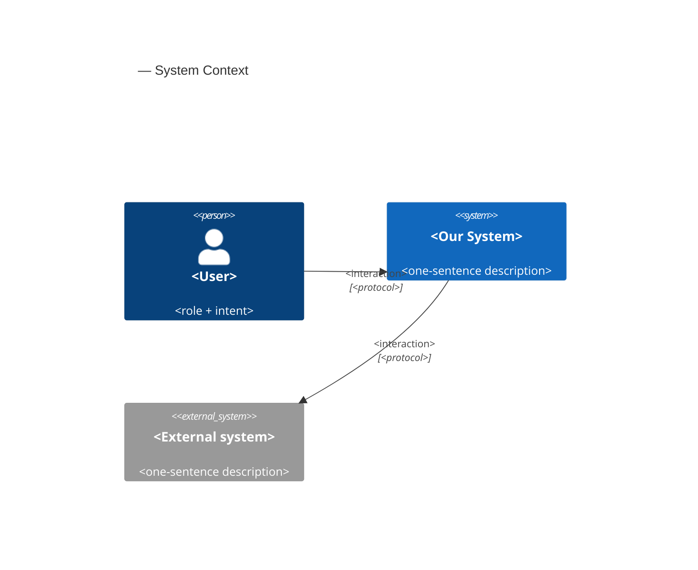
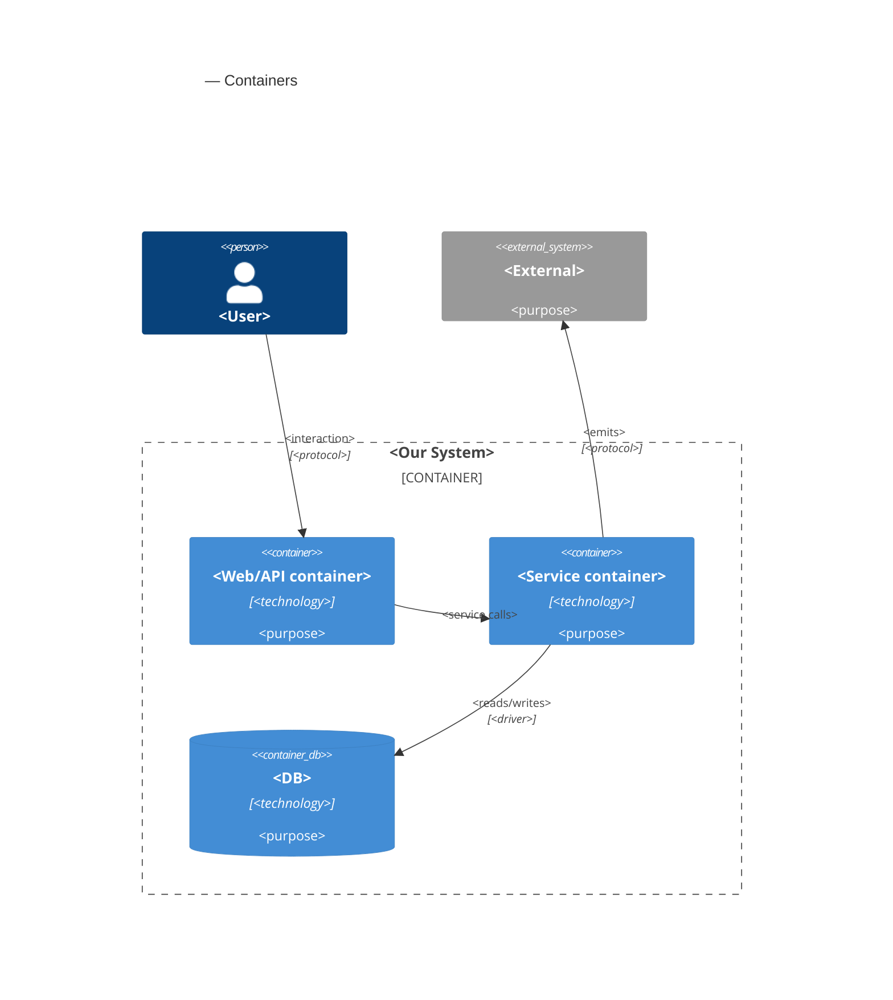
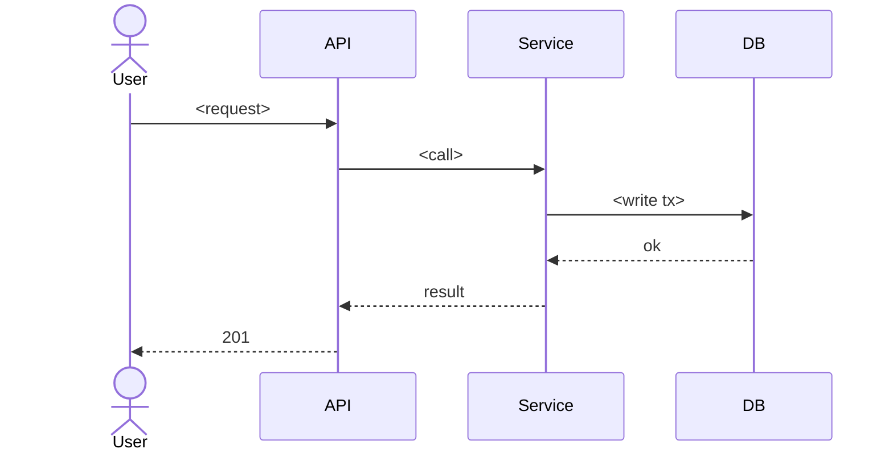

# Software Architecture Document — <system / feature>

<!-- Stages 04-05 → see sdlc/plugin/skills/architecture-design/SKILL.md -->
<!-- 12 Arc42 sections. Empty sections — <!-- N/A: <one-line reason> -->. -->
<!-- C4 Context (L1) lives inline in §3. C4 Container (L2) lives inline in §5. -->
<!-- §6 Runtime view seeds the primary flow(s) here; complete-sequence-diagrams (stage 06) then -->
<!--    fills §6 with every critical flow / §5 AC — no cap. -->
<!-- Numbers in §10 come VERBATIM from PRD §6 NFR — no inventing, no rounding. -->

## 1. Introduction and goals

<!-- 🎯 Why: a stable memory of «what + the three main qualities + who has a stake».       -->
<!--           A year later nobody will remember out loud WHICH THREE QUALITIES are critical. -->
<!-- 📋 What to write: 1 paragraph of intent + 3 lines of top-3 qualities + a stakeholders table. -->
<!-- 📌 Example: «QG-1: block editing speed p95 ≤500 ms»                                    -->

**Intent.** <One paragraph from PRD §Goals — what we're building and for whom.>

**Top-3 quality goals (1-liners; full scenarios in §10):**

1. <e.g. "Availability under partial failure of downstream module">
2. <e.g. "Performance for EM dashboard under team-scale growth">
3. <e.g. "Recoverability of checkpoints with <30 min RTO">

**Stakeholders.**

| Role | Interest | Sign-off owner? |
|---|---|---|
| <e.g. IC> | <feature usage> | No |
| <e.g. EM> | <dashboard reads> | No |
| <e.g. Tech Lead> | <SAD approval> | Yes |

<!-- Decision overrides (¶4) — populated by the Step-7 critic resolution loop, empty otherwise.       -->
<!-- Each: «Decision override: <headline> — rationale: <reason>» so downstream skills see the choice.  -->

## 2. Constraints

<!-- 🎯 Why: §4 (strategy) only works when §2 has recorded WHAT IS ALREADY FIXED:          -->
<!--           stack, versions, deadline, regulatory requirements. This is input, not output. -->
<!-- 📋 What to write: four blocks — Technical / Organizational / Conventions / Regulatory.  -->
<!-- 📌 Example: «Postgres 18» (not «Postgres»); «Q3 deadline — hard» (not «preferably»).    -->

**Technical.**
- <Language + version, e.g. Go 1.26>
- <Framework + version, e.g. chi v5.1, pgx v5.7>
- <Datastore + version, e.g. Postgres 18>
- <Architecture convention, e.g. hexagonal per CLAUDE.md>

**Organisational.**
- <Effort budget, e.g. 3 person-weeks>
- <Deadline, e.g. 2026-Q3 hard>
- <Team composition, e.g. 1 backend + 0.5 frontend>

**Conventions.**
- <Link to CLAUDE.md or project conventions>
- <Naming, ID strategy, error-handling pattern>

**Regulatory / external.**
- <e.g. GDPR — user deletion behavior per ADR-NNNN>
- <e.g. SOC2, PCI — applicable controls>

## 3. Context and scope

<!-- 🎯 Why: draws the SYSTEM BOUNDARY — who talks to it from outside, where the trust zone ends. -->
<!--           Without §3, §5 and §8 (authorization) blur — it's unclear what is «inside» and what is «outside». -->
<!-- 📋 What to write: 2-3 sentences of business context + a table of external systems + Mermaid C4Context. -->
<!-- 📌 Example: «external — none (a deliberate refusal of third parties in v1)» — that is a decision too. -->
<!-- Trust boundary — the line past which you don't trust data without checking it.          -->

<Business context in 2-3 sentences. What the system does for whom.>

**External systems (in / out):**

| Actor or system | Type | Interaction |
|---|---|---|
| <e.g. IC> | Person | Creates goals, adds checkpoints |
| <e.g. notification-service> | System (internal) | Receives cron registration |
| <e.g. Identity Provider> | System (external) | Provides JWT tokens |

**C4 Context (L1):**



## 4. Solution strategy

<!-- 🎯 Why: 3-4 STRATEGIC PILLARS that every ADR later grows from. Without §4 every ADR   -->
<!--           looks random — there is no umbrella. ⭐ The densest section — the ADR gate    -->
<!--           fires here almost always (decisions are irreversible + multi-module).         -->
<!-- 📋 What to write: first the Target surface(s), then 3-4 strategic choices.             -->
<!--           For each — a heading + 2-3 sentences of rationale.                            -->
<!-- 📌 The FIRST §4 decision — Target surface(s): WHAT EXACTLY we build. Written into the frontmatter -->
<!--           target_surfaces: [...] and gates §5 (one container per surface) + every       -->
<!--           later stage. Derived from PRD §1 «for whom» + the §4 roles. → _shared/surfaces.md -->
<!-- 📌 Example: «Store a lesson as a table of blocks» — the pillar ADR-0001 grew from.      -->

**Target surface(s) (the first decision — what's being built):** `<e.g. [backend-service, web-frontend]>`
<!-- Mirror this list into the frontmatter `target_surfaces`. For each declared UI surface          -->
<!-- (web-frontend / mobile-app / desktop-app) add a UI-architecture choice below (web → SSR/SPA/   -->
<!-- hybrid; mobile → native/cross-platform). Multi-surface is usually an ADR (multi-module +       -->
<!-- irreversible). The UI reuses the repo's existing design system / components / tokens from       -->
<!-- architecture-map.md §Frontend — it does not design greenfield. → _shared/surfaces.md           -->

**Top strategic choices (the seeds for ADRs):**

1. **<e.g. Module isolation through events>** — <2-3 sentences rationale referencing Quality Goals and constraints>.
2. **<e.g. Single-store persistence (Postgres)>** — <2-3 sentences>.
3. **<e.g. UI-architecture: SPA consuming the backend API>** — <per declared UI surface; 2-3 sentences>.

Each tactical decision in later sections should be traceable to one of these strategic seeds. Tactical decisions that *contradict* a strategic choice are red flags — surface them in §11 Risks.

## 5. Building block view

<!-- 🎯 Why: the INTERNAL DECOMPOSITION — modules, containers, DBs. The static topology:   -->
<!--           who may talk to whom. Without §5, §6 (scenarios) has no vocabulary of participants. -->
<!-- 📋 What to write: 1 paragraph on the style (layers/hexagonal/clean/event-driven) +    -->
<!--           a folder tree + Mermaid C4Container.                                         -->
<!-- 📌 ONE Container per declared target_surface (frontmatter): fullstack                -->
<!--           [backend-service, web-frontend] = backend-API container + web/SPA container; -->
<!--           [backend-service, mobile-app] = API + mobile app. Container(web, …) below is -->
<!--           just an example of one surface; add/replace it to match what §4 declared. → _shared/surfaces.md -->
<!-- 📌 Example: «web-app, content-api, media-worker, postgres, s3, cdn».                   -->

<One paragraph: layered / hexagonal / clean / event-driven. Why.>

**Internal decomposition:**

```
<e.g. internal/modules/goals/>
├── domain/       <entities + sentinel errors>
├── app/          <use cases / services>
├── infra/        <repository + outbox impl>
├── ports/        <HTTP handlers, DTOs, error mapping>
└── module.go     <self-wiring>
```

**C4 Container (L2):**



## 6. Runtime view

<!-- 🎯 Why: the RUNTIME FLOW for 1-2 critical scenarios. Who talks to whom, when and in what -->
<!--           order. Without §6, §5 is just a pile of boxes with no life.                     -->
<!-- 📋 What to write: a Mermaid sequenceDiagram. Participants — names from §5 (don't invent new ones!). -->
<!--           Messages are semantic («drafts a lesson»), WITHOUT HTTP methods/paths —      -->
<!--           endpoint-level sequence diagrams appear at stage 06 (api-forge).              -->
<!-- ⏳ RESERVED FOR SEQUENCES: architecture-design seeds only the primary flow(s) here.      -->
<!--           complete-sequence-diagrams (stage 06) EXTENDS §6 with every critical flow /   -->
<!--           every §5 AC — with no cap. Don't try to cover everything here.                -->
<!-- 📌 Example: «methodist → web-app: drafts a lesson → web-app → content-api: save».       -->

**Critical flow 1: <flow name>**



<!-- For XS/S: 1 flow above is enough. For M+: add 2-4 more (e.g. failure-mode flow, async flow). -->

**Critical flow 2: <e.g. async event propagation>** — <if applicable, otherwise N/A>.

## 7. Deployment view

<!-- 🎯 Why: the TOPOLOGY DevOps must know without reading Helm charts — how many replicas,  -->
<!--           where the background worker lives, AT WHAT NUMBERS we scale.                   -->
<!-- 📋 What to write: 2-3 sentences on the topology + metrics + alerts + concrete threshold numbers. -->
<!-- 📌 Example: «500 IC → partition by quarter» (not «we'll think about it when it grows»).  -->
<!-- 🎯 May be N/A for XS/S features that reuse the existing deployment unchanged.            -->

<Topology in 2-3 sentences. Where it runs (k8s / VM / serverless), replicas, scaling thresholds.>

**Monitoring:**
- <Metrics — e.g. Prometheus `<metric_name>`>
- <Alerts — e.g. "outbox lag > 10 min → page on-call">
- <Tracing — e.g. OpenTelemetry HTTP spans>

**Scaling thresholds:**
- <e.g. 500 IC × 5 goals × 26 checkpoints/Q = 65k rows/year — comfortable in one table>
- <e.g. partitioning by quarter at >500k rows/year>

<!-- For XS/S that doesn't change deployment: <!-- N/A: feature reuses existing deployment unit -->. -->

## 8. Crosscutting concepts

<!-- 🎯 Why: CROSSCUTTING PATTERNS that span several modules: logging, errors,           -->
<!--           authorization, ID strategy, outbox, cache. ⭐ The second densest section.    -->
<!--           If a pattern lives inside one module, it does NOT go here. If it is a        -->
<!--           convention of the whole project, it goes in CLAUDE.md.                       -->
<!-- 📋 What to write: a concept / convention / where-defined table. One row per concept.  -->
<!-- 📌 Example: «UUID v7 (time+random, sortable) in the app layer» — as the default from CLAUDE.md. -->

| Concept | Convention | Where defined |
|---|---|---|
| Logging | <e.g. structured slog, fields `module=<name>`> | <CLAUDE.md §X or here> |
| Authentication | <e.g. JWT via session middleware> | <CLAUDE.md §X> |
| Error handling | <e.g. domain sentinel → ports/errors.go → apperr JSON> | <CLAUDE.md §X> |
| ID strategy | <e.g. UUID v7 in app layer> | <CLAUDE.md §X> |
| Internationalisation | <e.g. N/A, English only> | — |
| Observability | <e.g. OpenTelemetry on HTTP boundaries> | — |
| Outbox / events | <module-specific patterns, if any> | <here> |

## 9. Architecture decisions

<!-- 🎯 Why: a REVERSE INDEX of the adr/ folder. `ls adr/` gives the files, §9 gives the meaning — -->
<!--           why they exist, which SAD slice they are attached to, what status they have.  -->
<!-- 📋 What to write: a table with 4 columns. One row per ADR. Mixed status is OK.          -->
<!-- 📌 Example: «0001 | Store a lesson as a table of blocks | Accepted | §4».                -->

| # | Title | Status | Section |
|---|---|---|---|
| <NNNN> | <imperative — e.g. "Use sliding window for rate limiting"> | Accepted | §<N> |
| <NNNN> | <imperative — e.g. "Co-locate outbox worker in API process"> | Accepted | §<N> |

ADR files live under `docs/features/<slug>/adr/NNNN-<title>.md`.

## 10. Quality requirements

<!-- 🎯 Why: the QUALITY TREE — take the goal from §1 and break it into                    -->
<!--           concrete leaves: tests, metrics, configs, drills. ⭐ Without §10, §1 is just a -->
<!--           manifesto. With §10 every declaration maps to something THAT CAN BE PROVEN.    -->
<!-- 📋 What to write: for each quality from §1 — When / Then / How verify. Numbers from PRD §6 NFR -->
<!--           VERBATIM (don't round p95 ≤250ms up to ≤300ms — that is a critic F6 error).     -->
<!-- 📌 Example: «p95 ≤500 ms per block UPDATE, verified by a k6 load test at 100 req/s».     -->

Each top-3 goal from §1 expanded into a full scenario:

**QG-1. <quality attribute>**
- **When:** <trigger condition>
- **Then:** <expected behavior with numbers from PRD NFR>
- **How verify:** <test / chaos drill / load test / observability>

**QG-2. <quality attribute>**
- **When:** <trigger>
- **Then:** <expected>
- **How verify:** <how>

**QG-3. <quality attribute>**
- **When:** <trigger>
- **Then:** <expected>
- **How verify:** <how>

## 11. Risks and technical debt

<!-- 🎯 Why: ⭐ collects EVERYTHING that can break — and not only the technical. Without §11 risks -->
<!--           are discussed at standups and get lost; debt stays in the head of the person -->
<!--           who took it on.                                                               -->
<!-- 📋 What to write: a risk/debt — severity — mitigation — owner table. Technical       -->
<!--           debt as a separate section.                                                   -->
<!-- 📌 Example: «EM doesn't push — member doesn't update data | High | …». The first risk is -->
<!--           often a product one, not a technical one. That's normal.                      -->

<!-- Severity column literals: Low / Medium / High for regular risks; "Open question" for rows
     created by Step-7 `Save as Open Question` resolutions (see references/socratic-loop.md). -->

| Risk / debt | Severity | Mitigation | Owner |
|---|---|---|---|
| <e.g. Outbox lag may reach hours during downstream outage> | Medium | <Alert >10 min, on-call playbook, retry backoff> | <DevOps> |
| <e.g. No event schema versioning in v1> | Medium | <ADR-NNNN planned for v2, graceful handling of unknown fields> | <Backend> |
| Open architectural decision: <decision-headline> | Open question | Resolve before <stage trigger or YYYY-MM-DD>; <inline rationale from Step-7 Save-as-OQ> | <owner> |

**Accepted debt (acceptable in v1, plan to fix later):**
- <e.g. Goal entity is not versioned (immutable) — OK for v1, may need audit versioning in v2>

## 12. Glossary

<!-- 🎯 Why: ⭐ a DOMAIN GLOSSARY that ends arguments a year later («checkpoint —           -->
<!--           weekly or biweekly? Quarter — calendar or fiscal?»).                          -->
<!-- 📋 What to write: a term / meaning table. Business and technical terms mixed together. -->
<!--           A term may carry a second language in its heading: «Goal (<term in the team's language>)». -->
<!-- 📌 Example: «Lesson | a lesson inside a course, made of blocks (text, video)».           -->

| Term | Meaning |
|---|---|
| <e.g. Goal> | <quarterly intent in statement form> |
| <e.g. KR> | <Key Result — measurable target linked to a Goal> |
| <e.g. Checkpoint> | <bi-weekly progress update on a KR> |
